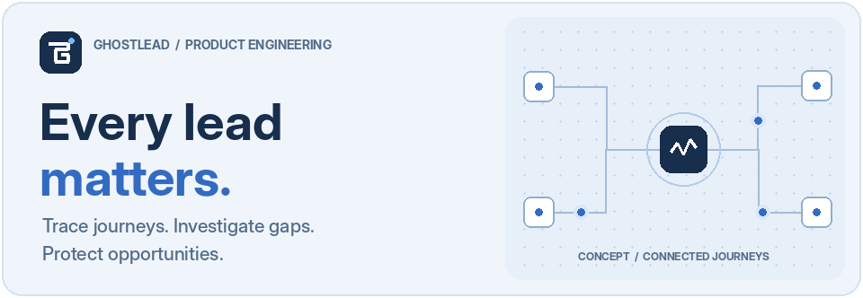
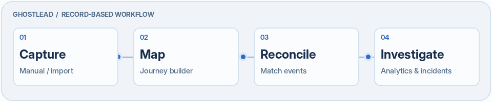
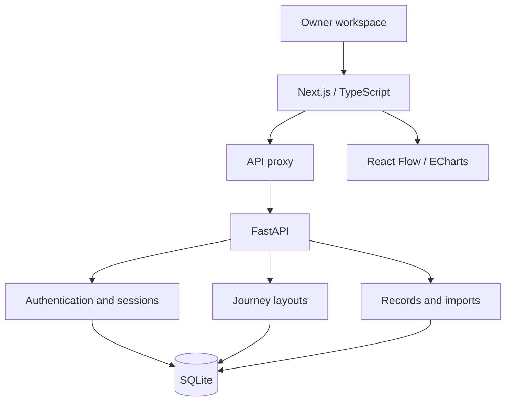
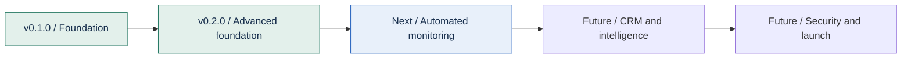

<div align="center">

# GhostLead



**Lead integrity & revenue protection**

[](https://github.com/milandevs006/ghostlead/tree/v0.2.0)


[Overview](#the-mission) · [Features](#features) · [Architecture](#architecture) · [Quick start](#getting-started-windows--vs-code) · [Roadmap](#development-roadmap)

[Static graphics for reduced motion](docs/assets/ghostlead-hero-static.png) · [Static workflow](docs/assets/ghostlead-flow-static.png)

</div>

---

## The mission

**Are business enquiries slipping through the cracks without anyone noticing?**

GhostLead is a local-first platform for documenting customer acquisition workflows, analysing lead delivery records and investigating potential failures across digital business channels. Our vision is a commercial monitoring platform for businesses and agencies.

> [!IMPORTANT]
> **v0.2.0 — Advanced Product Foundation** is a working local application. Automated website monitoring, discovery and CRM delivery verification are planned, not available in this release.



*Conceptual workflow using the current record-based functionality; the moving signals are decorative, not live activity or customer data.*

## Features

- **Workspace and authentication:** first-time owner setup, login/logout and persistent local storage.
- **Overview:** website inventory, recorded check results, lead matching and incident summaries.
- **Monitors:** configure monitors and manually record or import actual observations.
- **Journey builder:** create, connect, edit and save website-specific workflow stages using React Flow. Saved layouts do not execute monitoring jobs.
- **Lead explorer:** reconcile source and destination events using matching website and event identifiers.
- **Analytics:** website/date filters, monitoring trends, lead-flow diagrams, failure heatmaps, latency percentiles and website comparisons.
- **Incidents:** inspect failures derived from recorded observations.
- **Data imports:** CSV, XLSX and JSON with preview, validation, duplicate rejection and atomic confirmation.
- **Reports:** export recorded data and analytical summaries as CSV.
- **Interface:** responsive white-theme design, collapsible sidebar, workspace search and subtle transitions.

---

## Architecture



*Current architecture; analytics are calculated on the frontend from recorded data.*

## Technology stack

<div align="center">


</div>


| Layer | Technology |
| --- | --- |
| Frontend | Next.js, React, TypeScript, custom CSS |
| Visualisation | Apache ECharts, React Flow |
| Motion and icons | Motion, Lucide |
| Backend | Python, FastAPI, Uvicorn |
| Persistence | SQLAlchemy 2, SQLite |
| Authentication | Argon2 password hashing, server-side sessions |
| Data formats | CSV, JSON, XLSX (openpyxl) |
| Testing | Pytest, HTTPX, Node.js, TypeScript |
| Version control | Git, GitHub |

---

## Getting started (Windows / VS Code)

Install Python 3.11 or a compatible version, Node.js (the release was developed with Node.js 24), npm and Git. Internet access is required for dependency installation. No paid API or hosting subscription is needed for local development. The commands below use the existing Python environment; a virtual environment is optional.

Clone the repository if you do not already have a local copy (GitHub access is required for a private repository):

```powershell
git clone https://github.com/milandevs006/ghostlead.git
cd ghostlead
```

### Terminal 1 — backend (repository root)

```powershell
python -m pip install -r requirements.txt
python -m uvicorn app.main:app --host 127.0.0.1 --port 8000 --reload
```

### Terminal 2 — frontend (repository root)

```powershell
cd frontend
npm ci
npm run dev
```

Open **http://localhost:3000**. Keep both terminals running. Create an owner account on a fresh installation or sign in with your existing credentials. The legacy v0.1 interface is still available at http://127.0.0.1:8000; both interfaces use the same backend and database. Use port 3000 for the current frontend. Stop either server with Ctrl+C.

If an existing installation unexpectedly displays first-time setup, stop and verify its database location before creating another account. If you already have a working local repository, do not clone over it or replace its data directory.

## Data ownership and imports

**No demo data.** No pre-created account, seed records, artificial monitoring results or fabricated revenue figures are distributed. Business records are entered or imported by the authenticated owner. The application also creates internal account/session metadata, saved workflow metadata and import history as needed.

Download the header-only templates from **Data imports**. Register websites before importing dependent monitor and lead records. Select the file, validate and preview it, then confirm the import. Preview does not persist records; confirmation validates again and commits atomically. Invalid or duplicate records reject the batch.

| Record type | Fields |
| --- | --- |
| Websites | `name,url` |
| Monitors | `website_url,name,kind` |
| Monitor results | `website_url,monitor_name,observed_at,status,latency_ms,detail` |
| Lead events | `website_url,event_key,stage,observed_at` |

The new import centre accepts UTF-8 CSV, a single-sheet XLSX workbook without formulas, or a JSON array of objects. Limits: 1 MB and 10,000 rows per file. Use exact template field names and timezone-aware ISO 8601 timestamps. For lead records, use opaque event identifiers rather than personal information. See [Stage 2.5](STAGE-2.5.md) for formatting details.

Unmatched source events are not proof of lost customers. Check outcomes reflect recorded observations, not independently verified live health. Missing measurements remain empty. The overview excludes inconclusive checks from its pass-rate denominator; the Analytics Centre includes them in its recorded-check pass rate. These metrics should not be treated as identical. Analytics time buckets use UTC; see [Stage 2.4](STAGE-2.4.md) for matching and percentile definitions.

## Project structure

<details>
<summary>Expand the repository tree</summary>

```text
ghostlead/
├── app/                       # FastAPI, database, authentication and legacy UI
│   ├── main.py
│   ├── import_formats.py
│   └── static/
├── frontend/                  # Current Next.js frontend
│   ├── src/app/
│   │   ├── page.tsx
│   │   ├── globals.css
│   │   ├── journey-builder.tsx
│   │   ├── analytics-centre.tsx
│   │   ├── analytics-model.ts
│   │   └── import-centre.tsx
│   ├── tests/
│   ├── package.json
│   └── package-lock.json
├── templates/                 # Header-only CSV templates
├── tests/                     # Isolated backend tests
├── data/                      # Local database, created at runtime; not committed
├── requirements.txt
├── requirements-dev.txt
├── README.md
└── ROADMAP.md
```

</details>

## Testing

<details>
<summary>Expand backend, frontend and analytics test commands</summary>

Backend (repository root):

```powershell
python -m pip install -r requirements-dev.txt
python -m pytest -v
```

Frontend (from `frontend/`):

```powershell
npx tsc --noEmit
npm run build
```

Analytics calculation tests (PowerShell, from `frontend/`):

```powershell
npx tsc src/app/analytics-model.ts --strict --target es2020 --module commonjs --skipLibCheck --outDir "$env:TEMP/ghostlead-analytics-test"
node tests/analytics-model.test.cjs "$env:TEMP/ghostlead-analytics-test/analytics-model.js"
```

Tests use isolated temporary databases or in-memory fixtures. They do not seed the application workspace. Passing these checks does not establish production security or scalability.

</details>

## Storage and security

The default database is `data/ghostlead.db`. Stop the backend before backing up the entire `data/` directory to a secure location outside the repository. Do not commit the database, real customer records, credentials, tokens, private exports or backups. Review staged files before every commit. Deleting a website or monitor can cascade to dependent records; back up important data first.

The current release is designed for a single-owner local workspace. Do not expose either development server publicly or port-forward it. Public operation requires further security engineering, tenant isolation, HTTPS, access controls, privacy safeguards, monitoring infrastructure and deployment testing.

---

## Development roadmap



| Milestone | Status at v0.2.0 |
| --- | --- |
| Application foundation (v0.1.0) | Released |
| Advanced product foundation (v0.2.0) | Released |
| Domain verification and automated monitoring | Planned |
| CRM and API integrations | Planned |
| Real-time alerts and intelligence | Planned |
| Production security and multi-tenancy | Planned |
| Billing and subscriptions | Planned |
| Commercial launch | Planned |

Development takes place on `develop`; `main` holds tagged, stable development milestones. Keep release tags immutable and use new commits for subsequent documentation or code changes.

## Project documentation

- [Frontend migration](INSTALL.md)
- [Visual journey builder](STAGE-2.3.md)
- [Analytics centre](STAGE-2.4.md)
- [Advanced data imports](STAGE-2.5.md)
- [Roadmap](ROADMAP.md) (original planning notes)

GhostLead is under active development. Automated website discovery, live checks, CRM delivery verification, billing and public deployment are not included in v0.2.0.

---

<div align="center">

**GHOSTLEAD / EVERY LEAD MATTERS.**

Built with purpose. Developed in versioned milestones, with no fabricated metrics.

</div>
