<div align="center">

# GhostLead

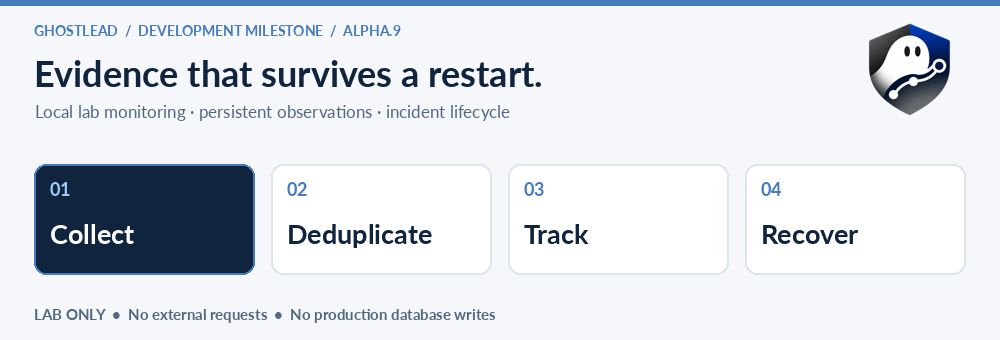

**Lead integrity & revenue protection**

![Development version]](https://img.shields.io/badge/develop-v0.3.0--alpha.9-2867A7?style=for-the-badge)
[![Stable release]](https://img.shields.io/badge/stable-v0.2.0-16796E?style=for-the-badge)]](https://github.com/milandevs006/ghostlead/tree/v0.2.0)
![Stage]](https://img.shields.io/badge/stage-3.9-597593?style=for-the-badge)
![Data]](https://img.shields.io/badge/data-zero_demo-16796E?style=for-the-badge)

[What is GhostLead?]](#what-is-ghostlead) · [What's new]](#whats-new-in-stage-39) · [How it works]](#how-it-works) · [Quick start]](#quick-start) · [Roadmap]](#development-roadmap)

[Animated edition](../../../README.md)

</div>

---

## What is GhostLead?

**Are business enquiries slipping through the cracks without anyone noticing?**

GhostLead is an evolving lead integrity platform for businesses and digital agencies. It brings customer acquisition journeys, recorded lead events, monitoring observations and domain intelligence together in one workspace.

- **Visualise** how a customer's enquiry is supposed to move through a business.
- **Investigate** unmatched lead events and recorded failures.
- **Understand** public domain infrastructure with real DNS lookups.

> [!IMPORTANT]
> This README describes **v0.3.0-alpha.9**, the Stage 3.9 development milestone on `develop`. The latest stable tagged release remains **v0.2.0**. External website crawling, persistent production scheduling, automated form submissions and CRM delivery verification are not implemented yet. The application is a single-owner local workspace, not a production-ready SaaS.

## What's new in Stage 3.9

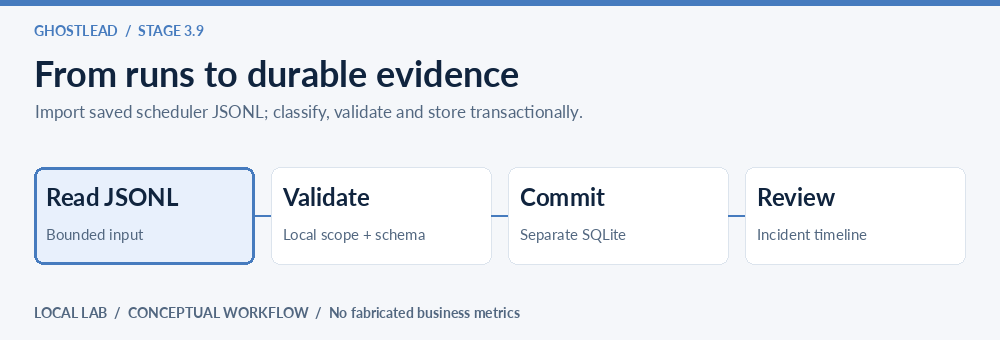

Save the scheduler's JSONL results and explicitly import them into a **separate lab-only SQLite evidence database**. The main workspace and scheduler are unchanged. Repeated findings update a single open incident per path and category; a healthy page observed in a completed run resolves its open incidents. Failed, partial or missing checks cannot imply recovery.

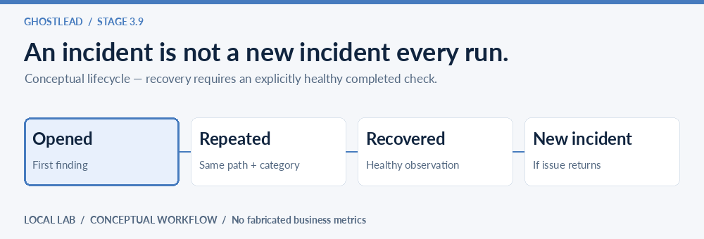

```powershell
# Start python -m lab.server in another terminal first.
$log = "$env:TEMP\ghostlead-lab-evidence.jsonl"
python -m lab.scheduler --interval-seconds 5 --runs 2 | Set-Content -Encoding utf8 $log
python -m lab.evidence import $log
python -m lab.evidence status
```

Exact normalized run replays are ignored. Conflicting IDs or new out-of-order runs reject the entire batch. The database is `~/.ghostlead-lab/evidence-v1.sqlite3`, outside the repo. No bodies, form values or production records are stored. The evidence importer does not authenticate logs; import only your own trusted lab output. Limits, backup guidance and exact Git commands: [Stage 3.9](../../../STAGE-3.9.md). The development target is still local-only; external monitoring is disabled. No background ingestion or automatic production incident processing is claimed.

## Scheduled monitoring (Stage 3.8)

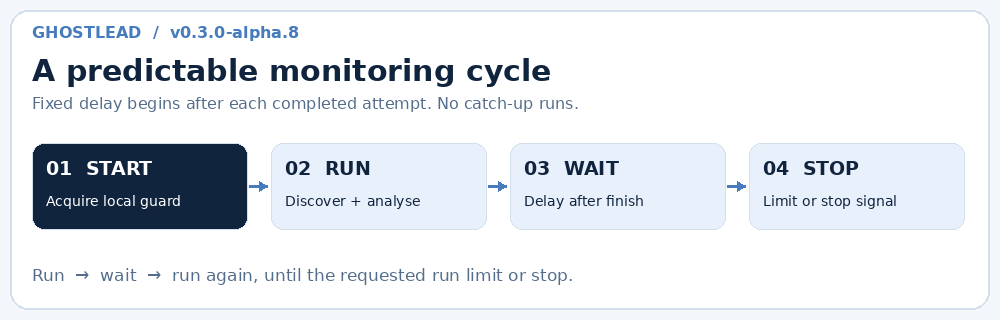

The standalone scheduler executes a finite series of real monitoring runs against **GhostLead Lab only**. It starts immediately, waits after each attempt, and never overlaps its own runs. Failed or partial attempts are recorded and do not trigger automatic retries. A second CLI scheduler is rejected while the first holds the fixed loopback TCP bind on port 5502. The guard does not prevent manual discovery or monitoring invocations.

Start `python -m lab.server` in one terminal. In a second terminal at the repository root:

```powershell
python -m lab.scheduler --interval-seconds 5 --runs 3
```

Default: three runs, 30 seconds between finished attempts. Allowed intervals: 5–3600 seconds; allowed run counts: 1–100. Ctrl+C requests a cooperative stop; a terminal-wide interrupt may also interrupt the current discovery worker. No persistent scheduler, automatic restart, external HTTP target or workspace database writes.

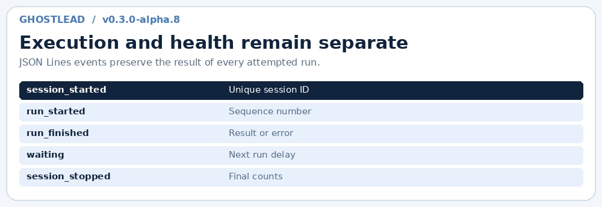

Each stdout line is a JSON event (`session_started`, `run_started`, `run_finished`, `waiting`, `session_stopped`) with session ID and UTC timestamp. Results include the original monitoring run ID, execution status and observed health; the final summary counts attempted runs by outcome. A completed execution can still detect website issues. To retain lab-only output outside the repository:

```powershell
python -m lab.scheduler --interval-seconds 5 --runs 3 | Set-Content -Encoding utf8 "$env:TEMP\ghostlead-lab-schedule.jsonl"
```

See [Stage 3.8](../../../STAGE-3.8.md) for bounds, stop semantics, exit codes, testing and GitHub commands. External connection-level safeguards remain pending. No monitoring data is injected into the actual workspace.

## Automated monitoring engine (Stage 3.7)

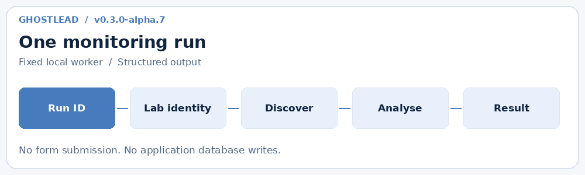

One command now runs discovery and performance analysis end-to-end against GhostLead Lab. Each result has a unique run ID, UTC timestamps, measured elapsed time, execution status, observed health, coverage and structured analysis.

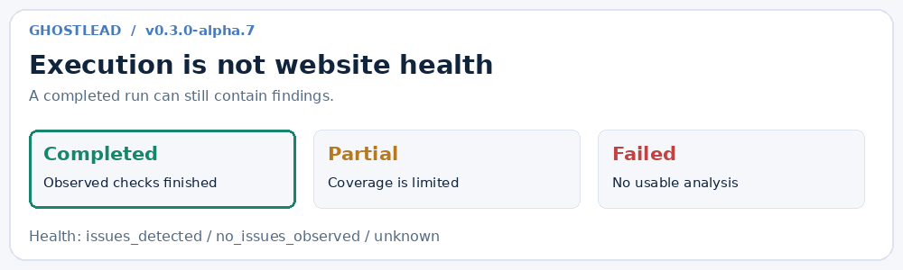

| Execution status | Exit code | Meaning |
| --- | --- | --- |
| completed | 0 | Eligible observations completed; issues may still be found. |
| partial | 2 | Incomplete, unchecked or truncated observations. |
| failed | 1 | No usable analysis; structured error code. |

Start `python -m lab.server` in one terminal, then run from the repository root in another:

```powershell
$r = python -m lab.monitoring | ConvertFrom-Json
$r | Select-Object run_id,execution_status,observed_health,duration_ms,error_code
$r.analysis.summary
$r.analysis.findings | Format-Table path,status,elapsed_ms,category,severity
```

A completed run is not an assertion of good website health. A local integration run observed seven pages and three deliberate fixture problems (404, 503 and a slow response). The worker runs with a 32-second subprocess timeout; startup and cleanup may add time. It is restricted to the fixed loopback origin and inherits the discovery limits. The single-run engine does not perform external HTTP monitoring, scheduling, real form submissions or database writes. Public-address pinning and external connection-level SSRF enforcement remain pending. See [Stage 3.7](../../../STAGE-3.7.md).

## Lab analysis (Stage 3.6)

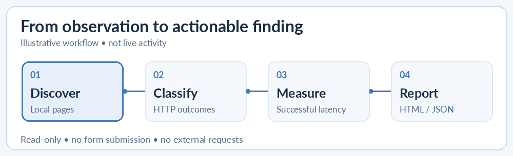

GhostLead Lab now converts real discovery observations into prioritised findings and standalone JSON or HTML reports. No database writes, external requests or form submissions.

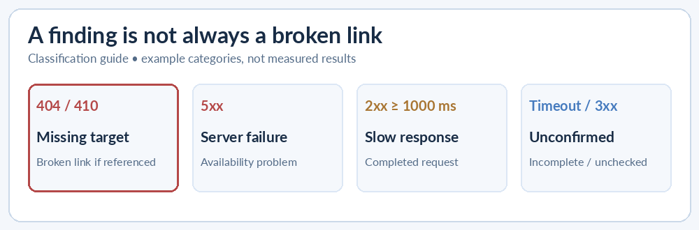

| Observation | Interpretation |
| --- | --- |
| Referenced HTTP 404/410 | Broken link (unique target, with observed referring pages) |
| HTTP 5xx | Server error, not necessarily a broken link |
| Completed HTTP 2xx at or above 1,000 ms | Slow response (initial lab threshold) |
| Other 4xx | Client error |
| Redirect | Unchecked; never followed |
| Timeout or incomplete response | Incomplete observation, not a confirmed broken link |

Latency uses only completed successful 2xx observations, including slow ones. Minimum, median, interpolated P95 and maximum describe this single discovery run. These are HTTP request/body-read timings, not browser rendering, Core Web Vitals or uptime guarantees. Missing samples remain null. No loss or revenue estimate is inferred.

From the root, start `python -m lab.server` in one terminal. In another:

```powershell
python -m lab.analysis
python -m lab.analysis --format html | Set-Content -Encoding utf8 "$env:TEMP\ghostlead-lab-report.html"
Invoke-Item "$env:TEMP\ghostlead-lab-report.html"
```

See [Stage 3.6](../../../STAGE-3.6.md). The core UI/backend remain alpha.3; this milestone adds a standalone lab tool, not external monitoring. Animations are conceptual and do not contain measured production data.

## Website discovery (Stage 3.5)

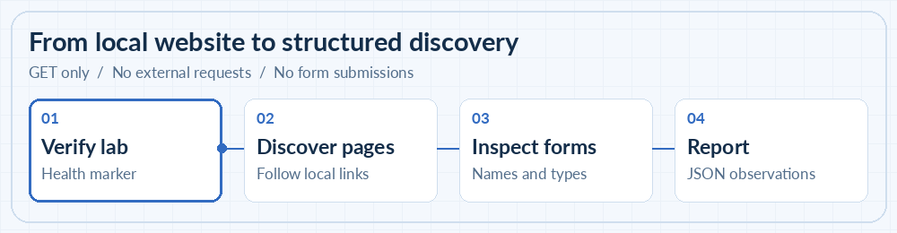

GhostLead now has a standalone, read-only discovery runner for **GhostLead Lab**. It follows internal HTML links, captures actual HTTP status codes and elapsed request times, and identifies form actions, methods, field names and types. It does not store field values, tokens, page bodies or lead records.

| Step | How it works |
| --- | --- |
| Identify lab | Check the fixed local service at `127.0.0.1:5501` using its health marker. |
| Discover | Visit the root and follow eligible same-origin links, deduplicated. |
| Inspect | Parse HTML using Python's standard library; no JavaScript execution. |
| Report | Print actual observations as JSON; no application database writes. |

Start `python -m lab.server` in one terminal. From the repository root in another:

```powershell
python -m lab.discovery
```

No custom target argument, external host, query string, redirect following, API crawling or form submission is supported. The runner has a 20-page cap, 256 KiB response cap, four-second socket timeout and a cooperative 25-second discovery budget (not a hard wall-clock deadline). Its health marker is a sanity check, not authentication. The normal application network safety policy still rejects localhost; this standalone lab tool is not an exception to that policy.

See [Stage 3.5](../../../STAGE-3.5.md) for commands and tests. The core UI and backend remain alpha.3; alpha.9 denotes the current standalone development milestone.

## Isolated testing environment (Stage 3.4)

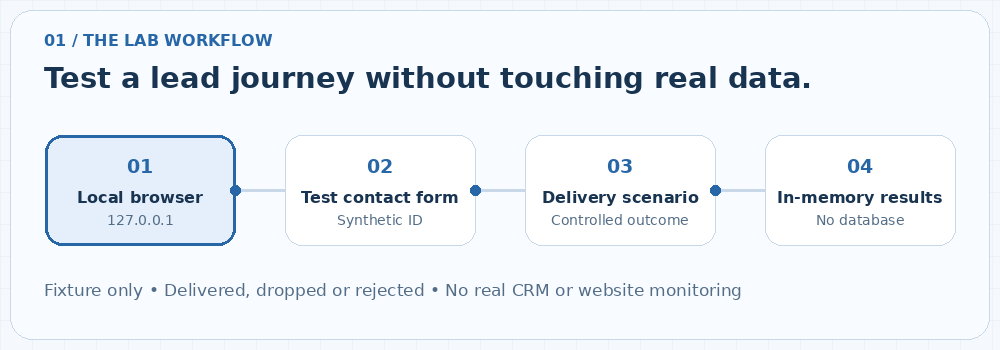

**GhostLead Lab** is a separate local development website for controlled tests. It is not connected to the GhostLead workspace or any real website. The core application runtime remains alpha.3; the lab was introduced in alpha.4.

| Fixture | Expected behaviour |
| --- | --- |
| Home, pricing, contact | Healthy HTTP 200 pages and internal navigation |
| Broken link | HTTP 404 |
| Slow page | Intentional two-second response delay |
| Unavailable page | HTTP 503 |
| Contact form | Synthetic ID, selectable delivery outcome |
| Lab results | At most 100 in-memory rows, cleared on restart |

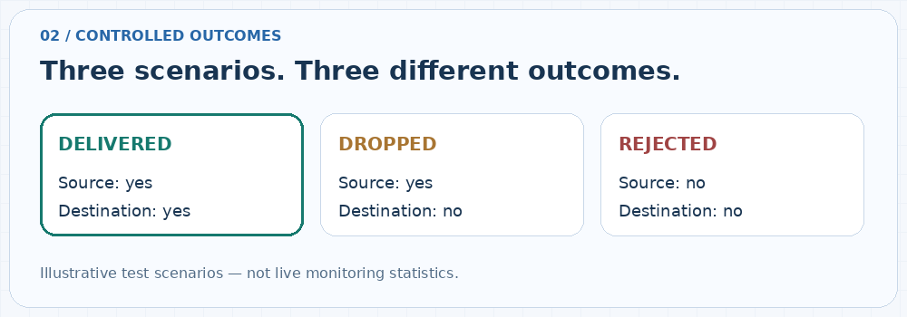

```powershell
python -m pytest tests/test_lab.py -v
python -m lab.server
```

From repository root; open http://127.0.0.1:5501. No GhostLead backend or frontend required. Only synthetic test IDs are accepted. Never add real customer information. The lab does not simulate a real remote CRM; it records controlled source/destination flags for future discovery and reconciliation tests. Public monitoring remains disabled and localhost remains blocked by the normal network safety policy.

See [Stage 3.4](../../../STAGE-3.4.md) for manual acceptance and limits.

## Network safety (Stage 3.3)

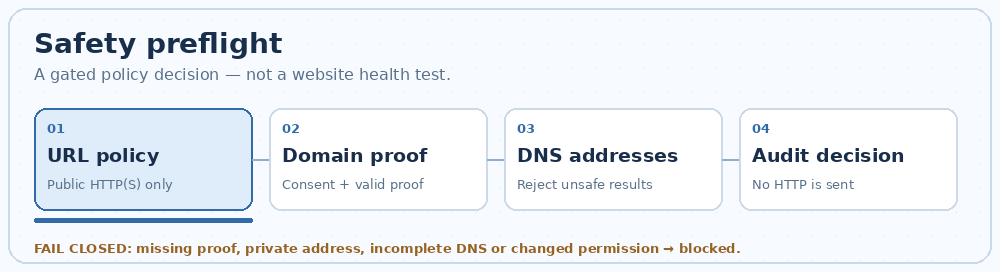

**Know whether a destination passes our preliminary safety rules before introducing HTTP monitoring.**

| New feature | What it does |
| --- | --- |
| Network safety page | Shows URL policy, verification status and HTTP monitoring disabled state. |
| Destination policy | Only canonical public HTTP(S) hostnames and default ports; rejects credentials, fragments, unsafe characters and IP literals. |
| Authorisation gate | Requires an active exact-host verification and recorded permission before resolving destination addresses. |
| Address validation | Checks all A and AAAA results; blocks private, loopback, link-local, multicast, reserved and disallowed transition addresses. Incomplete DNS fails closed. |
| Proof recheck | Rechecks URL, token and expiry after DNS resolution. |
| Redirect policy helper | Rejects cross-origin or protocol-changing redirects; three-hop maximum. Not connected to HTTP yet. |
| Audit history | Records up to 30 preflight decisions per website; no lead or monitor records are created. |
| Branding | Approved shield logo, favicon and reduced-motion-aware loading animation. |

Open **Network safety**, select a registered website and choose **Run safety preflight**. An unverified website is blocked and no destination lookup occurs. Public DNS intelligence remains available separately. There is a process-local 15-second cooldown for preflights.

> [!IMPORTANT]
> The preflight is advisory. It does not establish a safe HTTP connection or guarantee future DNS answers. Numeric-address connection pinning, peer validation, TLS and network isolation, redirect integration, total request timeouts and response limits must be implemented and tested before active monitoring. No target HTTP requests are sent in Stage 3.3.

See [Stage 3.3](../../../STAGE-3.3.md).

## Public website intelligence (Stage 3.2)

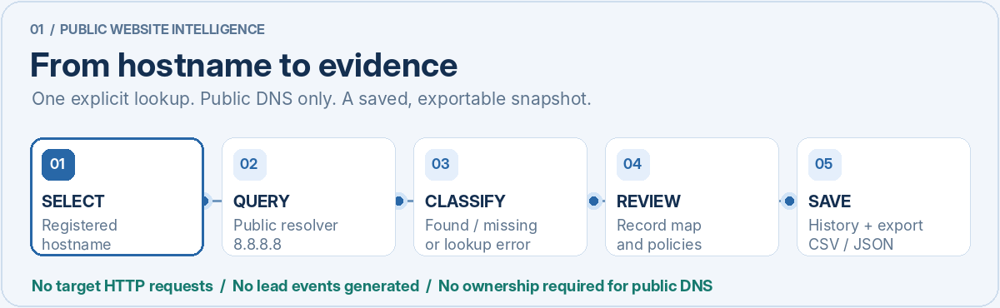

*Illustrative workflow; moving signals are animation, not live results.*

| Capability | What it does |
| --- | --- |
| Public website intelligence | Retrieves public DNS records for a registered hostname when the user requests a lookup. |
| DNS relationship map | Groups published record types into an understandable visual map. |
| Provider hints | Suggests a DNS provider based on known nameserver suffixes; not proof of web hosting. |
| Email and delegation signals | Displays published SPF, DMARC and DS information where available. |
| Lookup history | Stores up to 20 snapshots per website, including errors. |
| Record explorer and exports | Filters the selected snapshot and exports actual results as CSV or JSON. |
| Verification diagnostics | Separates missing names, missing TXT records, mismatches, timeouts and resolver failures. |

## How it works

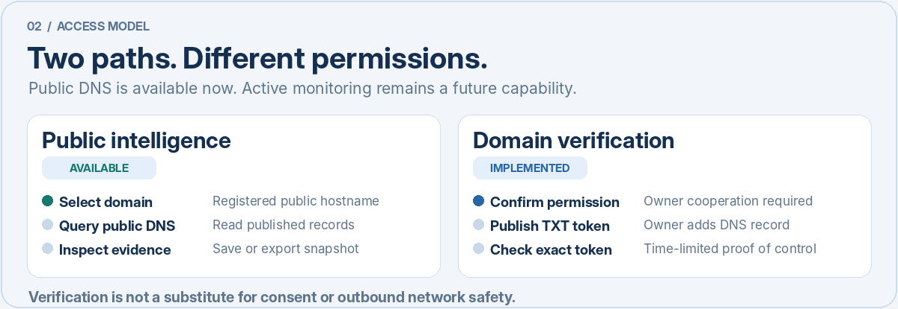

### Path A — Public website intelligence (available now)

1. Register a public website in your workspace.
2. Open **Website intelligence**, select the website and click **Analyse domain**.
3. GhostLead queries a fixed public recursive DNS resolver, `8.8.8.8`, and classifies the results.
4. Explore records, provider hints and the relationship map. Review history or export the selected snapshot.

No ownership verification is required for this public DNS feature. No lookup is made simply by opening the page. GhostLead does not connect to the target website, its returned IP addresses or its nameservers directly during this phase.

### Path B — Domain verification (implemented in Stage 3.1)

1. Select a registered website under **Verification** and confirm explicit testing permission.
2. Generate a unique challenge and share its TXT record instructions with the authorised DNS administrator.
3. The administrator publishes the exact token under `_ghostlead-verification.<hostname>`.
4. Click **Check DNS record**. GhostLead compares the returned token and records time-limited proof of control.

Challenges expire after 24 hours; successful verification is valid for 7 days and can be revoked. Never request the owner's DNS password. If you cannot obtain permission and cooperation, leave the website unverified. Live verification is still awaiting an authorised domain test. Stage 3.3 introduces preliminary safety policy; connection-level enforcement remains required.

### Read the DNS results

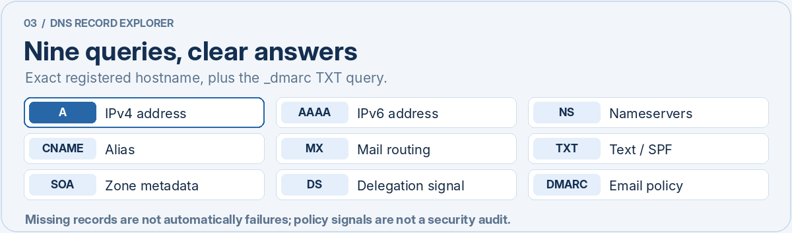

| Result | Interpretation |
| --- | --- |
| Found | The resolver returned one or more values. |
| No answer | The queried name exists but the requested record type was not returned. |
| NXDOMAIN | The queried DNS name does not exist according to the resolver. |
| Timeout / resolver error | The lookup could not complete; not evidence that a record is absent. |

Missing records are not automatically website failures. Queries target the exact hostname (and `_dmarc.<hostname>` for DMARC), not a complete zone inventory. SPF/DMARC/DS signals are not a full security audit, inherited policy check or DNSSEC validation. Reported TTL is the resolver-returned TTL.

<details>
<summary><b>Lookup limits and data handling</b></summary>

- Nine fixed DNS queries: A, AAAA, NS, CNAME, MX, TXT, SOA, DS and DMARC TXT.
- Three-second query lifetime, four workers, one lookup at a time and a process-local 15-second cooldown.
- Up to 20 values per query, 1,024 characters per value; truncated output is identified.
- Retains 20 snapshots per website. Older snapshots are pruned; deleting a website removes its snapshots.
- Uses conventional DNS via Google Public DNS, not encrypted DNS; no system resolver fallback. Do not submit private/internal hostnames.
- IP literals, local/reserved names and non-standard web ports are rejected by the hostname validator. This is not yet a complete SSRF defence.
- No monitoring observations or lead events are generated by DNS lookups.

See [Stage 3.2 implementation notes](../../../STAGE-3.2.md) for details.

</details>

---

## Product capabilities

| Workspace | Available functionality |
| --- | --- |
| Overview | Website inventory, recorded checks, lead matching, incident summaries. |
| Monitors | Configure monitors and enter or import actual observations. |
| Journey builder | Create, connect and persist website-specific workflow layouts; does not execute monitoring. |
| Lead explorer | Match source and destination events using website and event identifiers. |
| Analytics | Date and website filters, monitoring trends, lead flow, failure heatmaps, latency percentiles and comparisons. |
| Incidents | Review failures derived from recorded observations. |
| Data imports | CSV, XLSX and JSON with preview, validation, duplicate rejection and atomic confirmation. |
| Reports | CSV exports of recorded data and analytical summaries. |
| Verification | DNS TXT proof of control, explicit permission, expiry and revocation. |
| Website intelligence | Public DNS lookup, relationship map, historical snapshots and exports. |
| Network safety | Authorised DNS preflight, URL and address policy, decision history. No HTTP monitoring. |

**Zero demo data in the actual workspace.** The standalone lab has explicitly synthetic, temporary test scenarios only.  There are no pre-created accounts, fake businesses, synthetic monitoring results or fabricated revenue figures in the workspace. Unmatched source events are not proof of lost customers. Missing measurements stay empty. Existing lead analytics are calculated from user-supplied records, not live monitoring. See [Stage 2.4](../../../STAGE-2.4.md) for metric definitions, including the different pass-rate denominators used by Overview and Analytics.

## Architecture

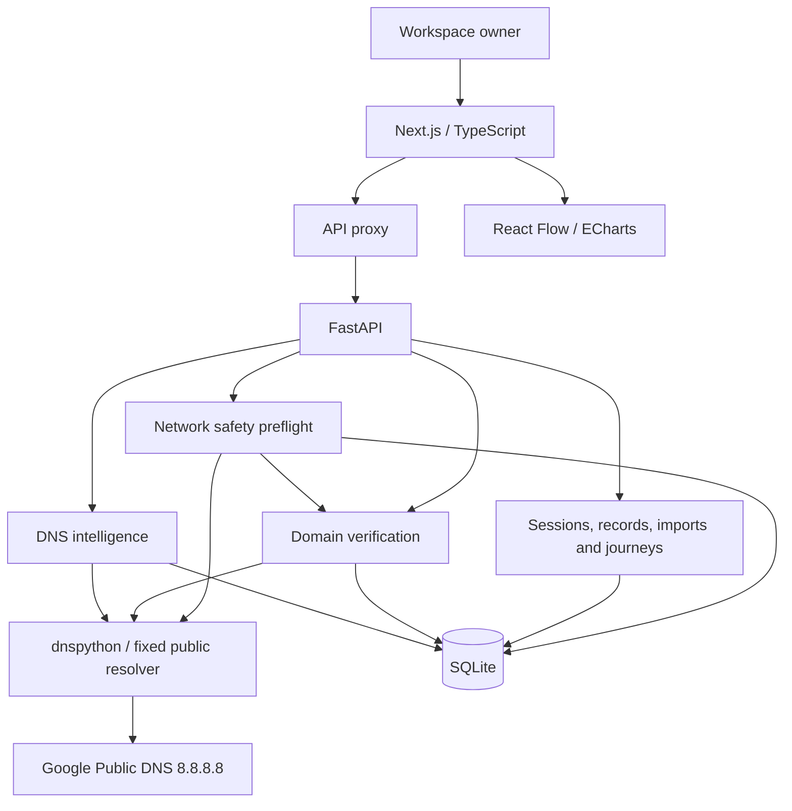

The DNS modules operate separately from customer lead records. There is no external automated HTTP monitoring worker in this milestone. The standalone lab scheduler invokes the local monitoring engine, which runs a separate discovery process using direct loopback HTTP only.

## Technology stack

<div align="center">

![Next.js]](https://img.shields.io/badge/Next.js-172E4C?style=for-the-badge&logo=nextdotjs&logoColor=white)
![React]](https://img.shields.io/badge/React-234A79?style=for-the-badge&logo=react&logoColor=white)
![TypeScript]](https://img.shields.io/badge/TypeScript-326BC1?style=for-the-badge&logo=typescript&logoColor=white)
![Python]](https://img.shields.io/badge/Python-326BC1?style=for-the-badge&logo=python&logoColor=white)
![FastAPI]](https://img.shields.io/badge/FastAPI-16796E?style=for-the-badge&logo=fastapi&logoColor=white)
![SQLite]](https://img.shields.io/badge/SQLite-234A79?style=for-the-badge&logo=sqlite&logoColor=white)
![ECharts]](https://img.shields.io/badge/Apache_ECharts-526D8A?style=for-the-badge&logo=apacheecharts&logoColor=white)
![React Flow]](https://img.shields.io/badge/React_Flow-326BC1?style=for-the-badge)
![dnspython]](https://img.shields.io/badge/dnspython-16796E?style=for-the-badge)

</div>

| Layer | Tools |
| --- | --- |
| UI | Next.js, React, TypeScript, custom CSS, Motion, Lucide |
| Visualisation | React Flow, Apache ECharts |
| API | Python, FastAPI, Uvicorn |
| Persistence | SQLAlchemy 2, SQLite |
| Identity | Argon2 password hashing, server-side sessions |
| DNS | dnspython, fixed public recursive DNS |
| Imports | CSV, JSON, openpyxl, defusedxml |
| Tests | Pytest, HTTPX, Node.js, TypeScript |

## Quick start

**Windows / VS Code.** Install Python 3.11 or a compatible version, Node.js (developed using Node.js 24), npm and Git. No paid services or virtual environment are required for local development. Internet access is required for dependency installation and public DNS lookups.

If you do not already have a working clone (repository access required):

```powershell
git clone https://github.com/milandevs006/ghostlead.git
cd ghostlead
git checkout develop
```

### Terminal 1 — backend (repository root)

```powershell
python -m pip install -r requirements.txt
python -m uvicorn app.main:app --host 127.0.0.1 --port 8000 --reload
```

### Terminal 2 — frontend (repository root)

```powershell
cd frontend
npm ci
npm run dev
```

Open **http://localhost:3000**. Keep both terminals running. Create an owner account only for a fresh installation; otherwise sign in with your existing credentials. The legacy UI remains at `http://127.0.0.1:8000`; use port 3000 for the current interface. If an existing installation unexpectedly shows setup, stop and check the database location before creating another account.

<details>
<summary><b>Data imports and storage</b></summary>

Download header-only templates from Data imports. Register websites before dependent records. Validate and preview the file, then confirm to save atomically. Invalid or duplicate records reject the batch.

| Record type | Template fields |
| --- | --- |
| Websites | `name,url` |
| Monitors | `website_url,name,kind` |
| Monitor results | `website_url,monitor_name,observed_at,status,latency_ms,detail` |
| Lead events | `website_url,event_key,stage,observed_at` |

CSV (UTF-8), XLSX (single sheet, no formulas) and JSON arrays of objects are supported. Limits: 1 MB and 10,000 rows per file. Use timezone-aware ISO 8601 timestamps and opaque lead identifiers rather than personal information.

Default database: `data/ghostlead.db`. Stage 3.1 and 3.2 add tables for domain proof and DNS snapshots without replacing the database. Stop the backend before backing up the entire `data/` directory to a secure location outside Git. Do not commit database files, credentials, customer records, tokens, private exports or backups. Deleting websites or monitors can cascade to dependent records.

</details>

<details>
<summary><b>Repository structure</b></summary>

```text
ghostlead/
├── app/
│   ├── main.py
│   ├── import_formats.py
│   ├── domain_verification.py
│   ├── dns_intelligence.py
│   ├── network_safety.py
│   └── static/
├── frontend/
│   ├── src/app/
│   │   ├── page.tsx
│   │   ├── journey-builder.tsx
│   │   ├── analytics-centre.tsx
│   │   ├── import-centre.tsx
│   │   ├── domain-verification.tsx
│   │   ├── dns-intelligence.tsx
│   │   ├── brand.tsx
│   │   └── network-safety.tsx
│   ├── tests/
│   └── package.json
├── lab/                     # Standalone local development fixtures
│   ├── server.py
│   ├── discovery.py
│   ├── analysis.py
│   ├── monitoring.py
│   ├── scheduler.py
│   └── evidence.py
├── tests/
│   ├── test_lab.py
│   ├── test_lab_scheduler.py
│   ├── test_lab_evidence.py
│   ├── test_lab_monitoring.py
│   ├── test_lab_analysis.py
│   ├── test_lab_discovery.py
│   ├── test_app.py
│   ├── test_domain_verification.py
│   ├── test_dns_intelligence.py
│   └── test_network_safety.py
├── templates/
├── docs/assets/v0.3-alpha.9/
├── data/                     # Local runtime data; not committed
├── requirements.txt
├── requirements-dev.txt
├── STAGE-3.1.md
├── STAGE-3.2.md
├── STAGE-3.3.md
├── STAGE-3.4.md
├── STAGE-3.5.md
├── STAGE-3.6.md
├── STAGE-3.7.md
├── STAGE-3.8.md
├── STAGE-3.9.md
└── README.md
```

</details>

## Testing and safety

<details>
<summary><b>Run the backend, frontend and analytics tests</b></summary>

From repository root:

```powershell
python -m pip install -r requirements-dev.txt
python -m pytest -v
```

From `frontend/`:

```powershell
npx tsc --noEmit
npm run build
npx tsc src/app/analytics-model.ts --strict --target es2020 --module commonjs --skipLibCheck --outDir "$env:TEMP/ghostlead-analytics-test"
node tests/analytics-model.test.cjs "$env:TEMP/ghostlead-analytics-test/analytics-model.js"
```

</details>

Stage 3.9 adds 25 evidence cases; all 114 lab regression cases passed in the Linux sandbox (37.54s). The real saved two-run lab import opened three incidents and repeated each once; importing it again ignored both run IDs. Recovery was verified with controlled tests, not a live recovery. Stage 3.8 adds 22 scheduler cases; all 89 lab, discovery, analysis, monitoring and scheduler tests passed in the Linux sandbox (38.24s). Stop the lab and scheduler before running the suite; ports 5501 and 5502 must be free. Windows acceptance and full application regression remain pending. Stage 3.7 adds 22 monitoring tests; all 67 lab, discovery, analysis and monitoring cases passed in the Linux development sandbox (20.92s). Stop the lab server before running these tests, because the new integration test binds port 5501. Windows acceptance and full application regression remain pending. Stage 3.6 adds 16 analysis test cases; all 45 lab, discovery and analysis cases passed in the development sandbox. Stage 3.5 adds 13 passing discovery tests in the development sandbox. Stage 3.4 adds 16 passing loopback-only lab integration tests in the development sandbox. These tests never contact external services or write to GhostLead’s database. Stage 3.3 was delivered with 41 passing backend test cases in the development sandbox using mocked DNS and isolated databases. A real public DNS lookup was observed in the Stage 3.2 local UI. Full Next.js build and live authorised preflight still require local verification. This is not a certification of the current repository or production readiness. Live owner-authorised domain verification remains pending.

Do not expose the development servers publicly. Public deployment requires further network isolation, tenant isolation, HTTPS, access controls, privacy safeguards and deployment testing. Active monitoring of third-party websites is outside the scope of this alpha.

## Development roadmap

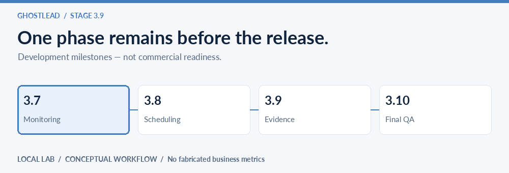

| Milestone | Status |
| --- | --- |
| v0.1.0 — Foundation | Released |
| v0.2.0 — Advanced foundation | Released / latest stable tag |
| 3.1 — Domain ownership verification | Implemented; live verification pending |
| 3.2 — Public website intelligence | Delivered; live public DNS lookup observed |
| 3.3 — Network safety controls | Policy delivered; HTTP connection enforcement remains pending |
| 3.4 — Isolated testing environment | Delivered; local lab and automated tests confirmed; full acceptance pending |
| 3.5 — Website and form discovery | Lab-only runner delivered; local acceptance pending |
| 3.6 — Broken link and performance analysis | Lab-only reporting delivered; local acceptance pending |
| 3.7 — Automated monitoring engine | Lab-only orchestration delivered; GitHub files verified |
| 3.8 — Scheduled monitoring | GitHub source verified |
| 3.9 — Evidence and incident detection | Delivered; local acceptance pending |
| 3.10 — Security and integration testing | Next |
| v0.3.0 — Stable local release | Target, not released |

PROJECT MONOLITH (OpenStatus-inspired UI redesign) remains on hold.

Development will pause after the v0.3.0 release. Future CRM/API integrations, production security, multi-tenancy, billing and commercial launch are deferred.

## Project documentation

[Frontend migration](../../../INSTALL.md) · [Journey builder](../../../STAGE-2.3.md) · [Analytics](../../../STAGE-2.4.md) · [Imports](../../../STAGE-2.5.md) · [Domain verification](../../../STAGE-3.1.md) · [Public DNS intelligence](../../../STAGE-3.2.md) · [Network safety](../../../STAGE-3.3.md) · [Isolated lab](../../../STAGE-3.4.md) · [Lab discovery](../../../STAGE-3.5.md) · [Lab analysis](../../../STAGE-3.6.md) · [Monitoring engine](../../../STAGE-3.7.md) · [Scheduled monitoring](../../../STAGE-3.8.md) · [Evidence and incidents](../../../STAGE-3.9.md) · [Original roadmap](../../../ROADMAP.md)

`develop` is the active development branch; `main` is the stable release branch. Each development phase updates the README, animation assets, version, roadmap, test evidence and installation notes. Keep existing release tags immutable. No fake metrics or live-status claims in the animations.

---

<div align="center">

**GHOSTLEAD / EVERY LEAD MATTERS.**

Build with purpose. Verify with evidence. Develop in versioned milestones.

</div>
