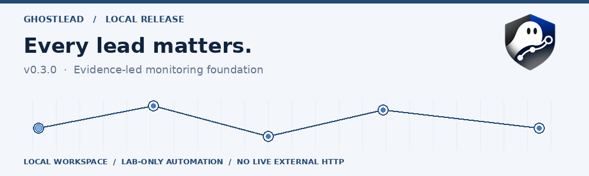
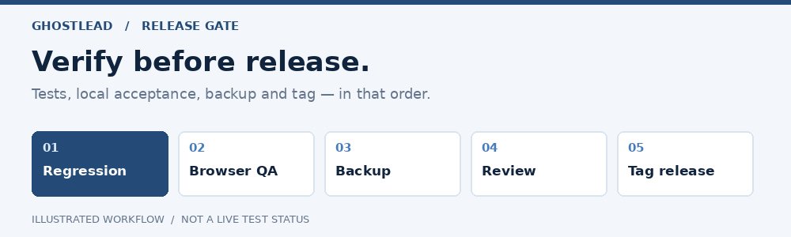
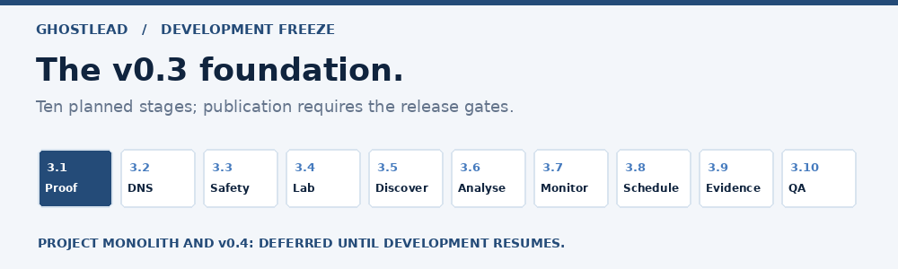

# GhostLead — v0.3.0 local monitoring foundation

Reduced-motion README. No animation is required to understand the project.

GhostLead is a local single-owner lead integrity workspace with website inventory, journey mapping, analytics, imports, domain proof, DNS intelligence and safety preflight. The separate loopback-only lab includes discovery, response analysis, bounded monitoring, finite scheduling and offline evidence/incident tracking. No synthetic records are injected into the actual workspace.

156 Python tests passed in Linux; strict standalone TypeScript analytics checks passed. Windows acceptance, full dependency-aware frontend build, browser checks and dependency audit review remain release gates. External HTTP monitoring remains disabled. This is not a production-ready SaaS or a security certification.

For installation, exact commands and backups: [Installation](../../../INSTALL.md) · [Stage 3.10](../../../STAGE-3.10.md) · [Release notes](../../../RELEASE-v0.3.0.md). Existing lab modules and earlier phase documentation are retained. PROJECT MONOLITH and v0.4 are postponed. Publish only after local acceptance; freeze development after the release.
